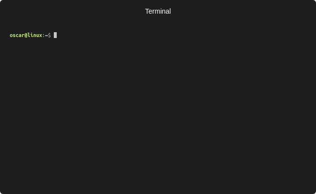

<h1 align="center">Netlify Dynamic DNS</h1>
<p align="center">
    </img>
</p>
<p align="center">
    A simple command line tool for updating a <a href="https://www.netlify.com/docs/dns/">Netlify's Managed DNS</a> record to point at your public IP address. Supporting both IPv4 and IPv6.
    <br />
    <br />
    <a href="https://goreportcard.com/report/github.com/oscartbeaumont/netlify-dynamic-dns"></img></a>
    <a href="https://paypal.me/oscartbeaumont" style="padding-left: 10px;"></img></a>
</p>

## Installation & Usage

```bash
# Install via script (Linux and macOS, x86 and ARM). Set PREFIX to install somewhere
# other than /usr/local, or NDDNS_VERSION=v3.0.3 to pin a release.
curl -fsSL https://raw.githubusercontent.com/oscartbeaumont/netlify-dynamic-dns/main/install.sh | sudo sh

# Set home.example.com to your public IP and quit
nddns -accesstoken xxx -zone example.com -record home

# Set home.example.com to your pulbic IP every 5 minutes
nddns -accesstoken xxx -zone example.com -record home -interval 5

# Using Docker (multi-arch: amd64, arm64 and armv7)
docker run ghcr.io/oscartbeaumont/netlify-dynamic-dns:latest -accesstoken xxx -zone example.com -record home -interval 5

# From Git
git clone https://github.com/oscartbeaumont/netlify-dynamic-dns.git
cd netlify-dynamic-dns
go run ./cmd -accesstoken xxx -zone example.com -record home
```

## Configuration

| Flag            | Environment Variable   | Default     | Description                                                                                                 |
|-----------------|------------------------|-------------|-------------------------------------------------------------------------------------------------------------|
| access-token    | NDDNS_ACCESS_TOKEN     |             | Your Netlify personal access token. Can be created at [here](https://app.netlify.com/account/applications) |
| zone            | NDDNS_ZONE             | example.com | The Netlify DNS zone domain name                                                                            |
| record          | NDDNS_RECORD           | home        | The record in the DNS zone to set as your public IP                                                         |
| ipv6            | NDDNS_IPv6_ENABLED     | true        | Whether the IPv6 record (AAAA) should also be updated                                                       |
| interval        | NDDNS_INTERVAL         | 0           | The amount of minutes between sending updates. If 0 only a single update is done.                            |
| ttl             | NDDNS_TTL              |             | The TTL in seconds for the DNS records (between 60 and 86400). Defaults to the existing record's TTL, or the update interval when there is none. |
| updaterootrecord| NDDNS_UPDATE_ROOT_RECORD | false     | Use to update the root record instead of a subdomain                                                        |

`zone` and `record` are validated on startup: surrounding whitespace is trimmed, `zone` must be a bare
domain name such as `example.com` and `record` must be a subdomain of it such as `home` or
`nddns.home`. The tool exits instead of retrying forever when the first update fails, so a typo in
your arguments is reported immediately.

By default the record's TTL follows your update interval (so a 5 minute interval gives a 5 minute
TTL, clamped to Netlify's 60 second to 1 day range) which stops resolvers caching a stale address.
If you have configured a TTL for the record in the Netlify dashboard it is preserved, and `--ttl`
overrides both.


## How It Works

Netlify Dynamic DNS uses the [OpenDNS](https://www.opendns.com) resolver to determine your public IP. The resolver has a feature which echoes the clients IP address when you lookup `myip.opendns.com`. This lookup is done both over IPv4 and IPv6 to determine both public IP's then using the [Netlify OpenAPI Client](https://github.com/netlify/open-api) new DNS records are created with your latest public IP and the old ones are removed.

Because Netlify's DNS API cannot update a record in place, every update recreates the records. The new records are created before the old ones are deleted, so the hostname keeps resolving to the previous address if a create fails. Every previous A/AAAA record of the types being updated is deleted afterwards, so stale duplicates left behind by an interrupted update are cleaned up rather than accumulating.

If the IPv6 lookup fails (the machine has no IPv6 connectivity) the update continues and only the IPv4 record is published. Pass `--ipv6=false` to skip the lookup entirely.

